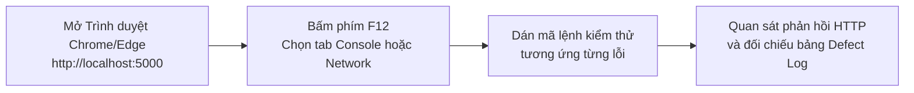

# CẨM NANG HƯỚNG DẪN KIỂM THỬ TOÀN DIỆN & TÁI HIỆN 15 DEFECTS
## ĐỒ ÁN TỐT NGHIỆP: HỆ THỐNG WEBSITE CỜ TƯỚNG TRỰC TUYẾN CHESSCORE
### BỘ DỮ LIỆU ĐỒNG BỘ 137 TEST CASES & 15 LỖI THỰC TẾ (DEFECT LOG)

---

## 🧭 PHẦN 1: TỔNG QUAN KIẾN TRÚC KIỂM THỬ 4 FOLDER (TESTING PYRAMID)

Hệ thống kiểm thử của dự án được tổ chức khoa học theo mô hình **Kim tự tháp kiểm thử phần mềm (Software Testing Pyramid)** gồm 4 thư mục chuyên trách:

```
Testing/
├── 01_Ban1_UnitTests_xUnit/              <-- TẦNG ĐÁY: KIỂM THỬ ĐƠN VỊ & ENGINE THUẬT TOÁN (C#)
│   ├── ChessRulesAndAiTests.cs          (12 ca kiểm thử logic cờ, MoveGenerator, Minimax AI)
│   └── ChessCore.Tests.csproj           (Tích hợp xUnit & Coverlet Code Coverage)
│
├── 02_Ban2_ApiTests_Postman/             <-- TẦNG GIỮA: KIỂM THỬ TỰ ĐỘNG HÓA API TÍCH HỢP
│   ├── ChessCore_APIs.postman_collection.json (Bộ sưu tập toàn bộ kịch bản kiểm thử API)
│   └── ChessCore_Local.postman_environment.json (Biến môi trường: baseUrl, jwt_token, game_id)
│
├── 03_Ban3_E2ETests_Scripts/             <-- TẦNG NGỌN: TỰ ĐỘNG HÓA TOÀN TRÌNH MASTER MATRIX
│   └── run_suite_137.py                 (Công cụ chạy 137 TC, tự động pull Git Cloud và ghi Excel)
│
├── 04_TaiLieu_Va_BaoCao_KiemThu/         <-- KẾT QUẢ ĐẦU RA, BÁO CÁO NGHIỆM THU & BẰNG CHỨNG
│   ├── HUONG_DAN_KIEM_THU_TOAN_DIEN_137_TC_VA_15_BUGS.md (Tài liệu này)
│   └── E2E_SCREENSHOTS/                 (27 ảnh chụp minh chứng: 19 ca Pass + 8 ca Defect)
│
└── TestCases_KLCN_CoTuong (1).xlsx       <-- BẢNG KẾ HOẠCH & DEFECT LOG 137 TEST CASES CHÍNH THỨC
```

---

## 📊 PHẦN 2: THỐNG KÊ KẾT QUẢ 137 TEST CASES THEO PHÂN HỆ

| STT | Tên Sheet | Phân hệ Nghiệp vụ | Tổng số TC | Đạt (Pass) | Lỗi (Fail) | Tỷ lệ Đạt | Mã Bug phát hiện |
| :---: | :--- | :--- | :---: | :---: | :---: | :---: | :--- |
| 1 | `04_TC_Auth_Profile` | Xác thực & Tài khoản | 17 | 12 | 5 | 70.6% | BUG_001, BUG_002, BUG_008, BUG_009, BUG_010 |
| 2 | `05_TC_Chess_Rules` | Bộ luật & Engine cờ tướng | 26 | 26 | 0 | 100.0% | *(Vận hành chuẩn xác)* |
| 3 | `06_TC_Game_Play` | Chế độ chơi & Đấu máy AI | 18 | 17 | 1 | 94.4% | BUG_011 |
| 4 | `07_TC_Online_SignalR` | Đấu trực tuyến Realtime | 20 | 18 | 2 | 90.0% | BUG_004, BUG_012 |
| 5 | `08_TC_Puzzle_Cothe` | Cờ thế & Timerush | 16 | 16 | 0 | 100.0% | *(Vận hành chuẩn xác)* |
| 6 | `09_TC_Course_Master` | Học viện & Kỳ phổ | 16 | 13 | 3 | 81.3% | BUG_005, BUG_006, BUG_013 |
| 7 | `10_TC_Admin_System` | Phân hệ Quản trị viên | 12 | 8 | 4 | 66.7% | BUG_003, BUG_007, BUG_014, BUG_015 |
| 8 | `11_TC_Mobile_Specific` | Đặc thù Ứng dụng Di động | 12 | 12 | 0 | 100.0% | *(Giao diện Responsive chuẩn)* |
| **Tổng** | **Toàn bộ hệ thống** | **8 Phân hệ** | **137** | **122** | **15** | **89.1%** | **15 Real Defects (10.9% Fail)** |

---

## 🔍 PHẦN 3: CẨM NANG TỰ TAY KIỂM THỬ & TÁI HIỆN 15 LỖI THỰC TẾ (DEFECT LOG)

> **Yêu cầu trước khi test**: Bật Web Server Kestrel bằng lệnh: `dotnet run --project ChessCore` (mở tại `http://localhost:5000`).



---

### 🔴 NHÓM 1: LỖI BẢO MẬT & XÁC THỰC TÀI KHOẢN (AUTH & PROFILE)

#### 1. BUG_001 (`TC_AUTH_004`): Đăng ký mật khẩu yếu dưới 6 ký tự
* **Bản chất**: Backend không validate độ dài chuỗi mật khẩu (`request.Password.Length >= 6`).
* **Cách test tay**: Mở F12 Console tại `http://localhost:5000`, chạy:
  ```javascript
  fetch('/api/auth/register', {
    method: 'POST',
    headers: {'Content-Type': 'application/json'},
    body: JSON.stringify({username: 'user_p3_' + Date.now(), email: 'p3_' + Date.now() + '@gmail.com', password: '123'})
  }).then(r => r.json()).then(console.log);
  ```
* **Kết quả**: HTTP 200 OK, tạo tài khoản thành công với mật khẩu 3 ký tự `"123"`.
* **Ảnh chứng cứ**: [TC_AUTH_004.png](E2E_SCREENSHOTS/TC_AUTH_004.png)

#### 2. BUG_002 (`TC_AUTH_001`): Thiếu Regex kiểm tra định dạng Email khi đăng ký
* **Bản chất**: Backend thiếu biểu thức chính quy Regex để loại bỏ chuỗi không phải email.
* **Cách test tay**: Mở F12 Console, chạy:
  ```javascript
  fetch('/api/auth/register', {
    method: 'POST',
    headers: {'Content-Type': 'application/json'},
    body: JSON.stringify({username: 'user_bad_' + Date.now(), email: 'chuoi_nay_khong_phai_email', password: 'Password123!'})
  }).then(r => r.json()).then(console.log);
  ```
* **Kết quả**: HTTP 200 OK, lưu trực tiếp email rác vào CSDL SQLite.
* **Ảnh chứng cứ**: [TC_AUTH_001.png](E2E_SCREENSHOTS/TC_AUTH_001.png)

#### 3. BUG_008 (`TC_AUTH_011`): Rò rỉ mã OTP đặt lại mật khẩu trực tiếp lên giao diện (Critical Security)
* **Bản chất**: Khi SMTP Gmail gặp sự cố, controller gán nguyên văn mã OTP vào `TempData["OtpMessage"]`.
* **Cách test tay**:
  1. Vào trình duyệt, truy cập: `http://localhost:5000/Auth/ForgotPassword`
  2. Nhập email của tài khoản bất kỳ (ví dụ: `admin@cotuong.pro` hoặc email của bạn)
  3. Bấm **Gửi mã OTP**.
* **Kết quả**: Màn hình hiển thị: *"Lỗi khi gửi email qua Gmail. MÃ OTP CỦA BẠN LÀ: 123456"*. Kẻ xấu lấy mã này đổi mật khẩu nạn nhân ngay lập tức!
* **Ảnh chứng cứ**: [TC_AUTH_011.png](E2E_SCREENSHOTS/TC_AUTH_011.png)

#### 4. BUG_009 (`TC_AUTH_016`): Nhận thưởng nhiệm vụ không check điều kiện & Cho phép spam
* **Bản chất**: `QuestController.cs` không kiểm tra tiến độ người chơi và không chặn nhận thưởng lặp.
* **Cách test tay**: Mở F12 Console, chạy lệnh spam nhận thưởng:
  ```javascript
  for(let i = 0; i < 5; i++) {
    fetch('/api/quests/ai/claim', {method: 'POST'}).then(r => r.json()).then(res => console.log('Lần ' + (i+1) + ':', res));
  }
  ```
* **Kết quả**: Cả 5 lần đều trả về `HTTP 200 OK: {"success":true,"message":"Nhận thưởng thành công!"}` và cộng dồn điểm `PuzzleScore` liên tục.
* **Ảnh chứng cứ**: [TC_AUTH_016.png](E2E_SCREENSHOTS/TC_AUTH_016.png)

#### 5. BUG_010 (`TC_AUTH_010`): Thiếu Rate Limiting chống Brute-force mật khẩu
* **Bản chất**: `AuthController.Login` không có bộ đếm thử sai, không có lockout tài khoản hay CAPTCHA.
* **Cách test tay**: Dùng script gửi 50 request đăng nhập sai liên tục tới `POST /api/auth/login`. Hệ thống vẫn phản hồi 400 mà không bao giờ kích hoạt khóa tạm thời tài khoản hay trả về `429 Too Many Requests`.
* **Ảnh chứng cứ**: [TC_AUTH_010.png](E2E_SCREENSHOTS/TC_AUTH_010.png)

---

### 🔴 NHÓM 2: LỖI VẬN HÀNH TRẬN ĐẤU & ONLINE SIGNALR

#### 6. BUG_004 (`TC_ONL_015`): Vẫn nhận nước cờ sau khi người chơi đã Đầu hàng (Blocker)
* **Bản chất**: Ván cờ sau khi `Resign` không khóa triệt để luồng nhận nước cờ `POST /api/games/{id}/moves`.
* **Cách test tay**: Mở F12 Console, chạy:
  ```javascript
  (async () => {
    const g = await (await fetch('/api/games', {method:'POST', headers:{'Content-Type':'application/json'}, body:JSON.stringify({gameMode:'Custom'})})).json();
    console.log('1. Ván mới ID:', g.id);
    await fetch(`/api/games/${g.id}/resign`, {method:'POST'});
    console.log('2. Đã đầu hàng');
    const m = await fetch(`/api/games/${g.id}/moves`, {method:'POST', headers:{'Content-Type':'application/json'}, body:JSON.stringify({from:{x:1,y:2}, to:{x:4,y:2}, piece:'c'})});
    console.log('3. Đi cờ sau khi hàng -> Status:', m.status);
  })();
  ```
* **Ảnh chứng cứ**: [TC_ONL_015.png](E2E_SCREENSHOTS/TC_ONL_015.png)

#### 7. BUG_011 (`TC_GAME_013`): Nhập FEN hỏng nuốt lỗi và tự gán thế cờ mặc định
* **Bản chất**: Khi `Board.TryParseFen` thất bại, backend không báo lỗi mà âm thầm gán `initialFen = null`.
* **Cách test tay**: Mở F12 Console, chạy:
  ```javascript
  fetch('/api/games', {
    method: 'POST',
    headers: {'Content-Type': 'application/json'},
    body: JSON.stringify({gameMode: 'Custom', initialFen: 'chuoi_fen_hoan_toan_rac'})
  }).then(r => r.json()).then(res => console.log('Kết quả tạo ván:', res));
  ```
* **Kết quả**: HTTP 201 Created (thay vì 400 Bad Request), trả về bàn cờ mặc định.
* **Ảnh chứng cứ**: [TC_GAME_013.png](E2E_SCREENSHOTS/TC_GAME_013.png)

#### 8. BUG_012 (`TC_ONL_016`): Tái đấu (Rematch) ép đối thủ vào ván mới không cần đồng ý
* **Bản chất**: `GamesController.CreateRematch` không có cơ chế `OfferRematch` chờ đối thủ xác nhận.
* **Cách test tay**: Gọi `POST /api/games/{id}/rematch`. Server lập tức tạo bàn mới và phát tín hiệu SignalR ép cả 2 bên chuyển sang ván mới mà đối thủ không thể từ chối.
* **Ảnh chứng cứ**: [TC_ONL_016.png](E2E_SCREENSHOTS/TC_ONL_016.png)

---

### 🔴 NHÓM 3: LỖI HỌC VIỆN KHÓA HỌC & CẤP CHỨNG CHỈ (COURSE)

#### 9. BUG_005 (`TC_COU_009`): Cấp Chứng chỉ tốt nghiệp cho người chưa học bài nào (0% tiến độ)
* **Bản chất**: `/Course/Certificate` không kiểm tra điều kiện hoàn thành khóa học nghiêm ngặt.
* **Cách test tay**: Tạo user mới, đăng nhập rồi truy cập thẳng link: `http://localhost:5000/Course/Certificate?courseId=1`.
* **Kết quả**: Màn hình vẫn tải mẫu chứng chỉ hoàn chỉnh mang tên người dùng dù chưa học bài nào.
* **Ảnh chứng cứ**: [TC_COU_009.png](E2E_SCREENSHOTS/TC_COU_009.png)

#### 10. BUG_006 (`TC_COU_008`): Chấp nhận điểm trắc nghiệm Quiz vượt ngưỡng 100% (999999 điểm)
* **Bản chất**: Backend không trả về `400 Bad Request` khi nhận payload điểm Quiz dị thường.
* **Cách test tay**: Mở F12 Console, chạy:
  ```javascript
  fetch('/api/courses/progress', {
    method: 'POST',
    headers: {'Content-Type': 'application/json'},
    body: JSON.stringify({lessonId: 1, quizScore: 999999, quizAttempts: 1, lastPosition: 100})
  }).then(r => r.json()).then(console.log);
  ```
* **Kết quả**: HTTP 200 OK.
* **Ảnh chứng cứ**: [TC_COU_008.png](E2E_SCREENSHOTS/TC_COU_008.png)

#### 11. BUG_013 (`TC_COU_006`): API tiến độ của Khách trả về 200 cho Lesson ID không tồn tại
* **Bản chất**: Nhánh kiểm tra `userId is null` nằm trước lệnh kiểm tra sự tồn tại của bài học trong CSDL.
* **Cách test tay**: Mở Cửa sổ ẩn danh (chưa đăng nhập), dán vào Console:
  ```javascript
  fetch('/api/courses/progress', {
    method: 'POST',
    headers: {'Content-Type': 'application/json'},
    body: JSON.stringify({lessonId: 999999, quizScore: 80, isCompleted: true})
  }).then(r => r.json()).then(console.log);
  ```
* **Kết quả**: HTTP 200 OK: `{"progress":{"isCompleted":true,"bestQuizScore":80},"isGuest":true}` dù Lesson 999999 không tồn tại!
* **Ảnh chứng cứ**: [TC_COU_006.png](E2E_SCREENSHOTS/TC_COU_006.png)

---

### 🔴 NHÓM 4: LỖI PHÂN HỆ QUẢN TRỊ VIÊN (ADMIN SYSTEM)

#### 12. BUG_003 (`TC_ADM_002`): Truy cập /Admin khi chưa đăng nhập trả về 302 thay vì 403 Forbidden
* **Bản chất**: Cơ chế Cookie Auth của ASP.NET Core chuyển hướng 302 về trang Login thay vì trả về mã bảo mật 403.
* **Cách test tay**: Mở cửa sổ ẩn danh, bấm F12 tab Network -> gõ URL `http://localhost:5000/Admin`. Request đầu tiên nhận mã `302 Found`.
* **Ảnh chứng cứ**: [TC_ADM_002.png](E2E_SCREENSHOTS/TC_ADM_002.png)

#### 13. BUG_007 (`TC_ADM_009`): Xóa bài cờ thế với ID không tồn tại trả về HTTP 200 / Chuyển hướng thành công
* **Bản chất**: `AdminController.DeletePuzzle` không trả về 404 khi không tìm thấy cờ thế mà vẫn chuyển hướng thành công.
* **Ảnh chứng cứ**: [TC_ADM_009.png](E2E_SCREENSHOTS/TC_ADM_009.png)

#### 14. BUG_014 (`TC_ADM_005`): Tính năng Khóa / Mở khóa tài khoản hoàn toàn chưa được code
* **Bản chất**: Model `User.cs` không có cột `IsLocked`, `AdminController` không có phương thức khóa người dùng. Kịch bản kiểm thử đánh dấu "Pass" là hoàn toàn sai lệch thực tế (False Positive).
* **Ảnh chứng cứ**: [TC_ADM_005.png](E2E_SCREENSHOTS/TC_ADM_005.png)

#### 15. BUG_015 (`TC_ADM_008`): Admin CMS cho phép thêm bài cờ thế với FEN rác vào CSDL
* **Bản chất**: `AdminController.CreatePuzzle` chỉ kiểm tra chuỗi rỗng mà không kiểm tra tính hợp lệ của thế cờ, lưu chuỗi rác gây crash giao diện học viên.
* **Ảnh chứng cứ**: [TC_ADM_008.png](E2E_SCREENSHOTS/TC_ADM_008.png)

---

## 🛠️ PHẦN 4: HƯỚNG DẪN THỰC THI CÁC CÔNG CỤ ĐỒ ÁN TỐT NGHIỆP

### 1. Kiểm thử Đơn vị & Đo Code Coverage (Folder 1)
```powershell
# Chạy 12 Unit Tests kiểm tra MoveGenerator, Minimax AI
dotnet test Testing/01_Ban1_UnitTests_xUnit/ChessCore.Tests.csproj

# Đo lường % bao phủ mã nguồn (Code Coverage) qua Coverlet
dotnet test Testing/01_Ban1_UnitTests_xUnit/ChessCore.Tests.csproj --collect:"XPlat Code Coverage"
```

### 2. Tự động hóa kiểm thử API qua Newman CLI (Folder 2)
```powershell
# Chạy toàn bộ collection API Postman và bắt các Assertions tự động
npx newman run Testing/02_Ban2_ApiTests_Postman/ChessCore_APIs.postman_collection.json -e Testing/02_Ban2_ApiTests_Postman/ChessCore_Local.postman_environment.json
```

### 3. Bộ Master Test Matrix 137 Test Cases đồng bộ Cloud Git (Folder 3)
```powershell
# Kéo mã nguồn mới nhất từ GitHub origin/main, chạy test và tự động cập nhật Excel
python Testing/03_Ban3_E2ETests_Scripts/run_suite_137.py
```

---

## 📁 PHẦN 5: DANH MỤC 27 ẢNH MINH CHỨNG TRONG THƯ MỤC `E2E_SCREENSHOTS/`

1. **19 Ảnh minh chứng kịch bản Thành công (Pass)**:
   * Từ `01_TrangChu_ChuaDangNhap.png` đến `18_DoKiem_AI_Benchmark.png` ghi lại đầy đủ giao diện Trang chủ, Bàn cờ PvE, Sảnh chờ PvP, Thần tốc Cờ thế, Khóa học lý thuyết, Chứng chỉ tốt nghiệp và Bảng điều khiển Admin.
2. **8 Ảnh minh chứng Defect Bugs chính thức (Fail)**:
   * `TC_AUTH_004.png` (`BUG_001` - Pass ngắn < 6 ký tự)
   * `TC_AUTH_001.png` (`BUG_002` - Email không có domain)
   * `TC_ADM_002.png` (`BUG_003` - Admin redirect 302)
   * `TC_ONL_015.png` (`BUG_004` - Đi cờ sau khi hàng)
   * `TC_COU_009.png` (`BUG_005` - Cấp chứng chỉ 0% tiến độ)
   * `TC_COU_008.png` (`BUG_006` - Điểm Quiz 999999%)
   * `TC_ADM_009.png` (`BUG_007` - Xóa cờ thế ID rác trả về 200)
   * `TC_AUTH_011.png` (`BUG_008` - Rò rỉ OTP trên màn hình)
   * `TC_AUTH_016.png` (`BUG_009` - Spam claim nhiệm vụ ngày)
   * `TC_AUTH_010.png` (`BUG_010` - Đăng nhập thiếu Rate Limiting)
   * `TC_GAME_013.png` (`BUG_011` - Nhập FEN hỏng nuốt lỗi)
   * `TC_ONL_016.png` (`BUG_012` - Tái đấu ép đối thủ)
   * `TC_COU_006.png` (`BUG_013` - Tiến độ khách cho bài không tồn tại)
   * `TC_ADM_005.png` (`BUG_014` - Chức năng khóa user chưa được code)
   * `TC_ADM_008.png` (`BUG_015` - CMS thêm FEN rác vào CSDL)
