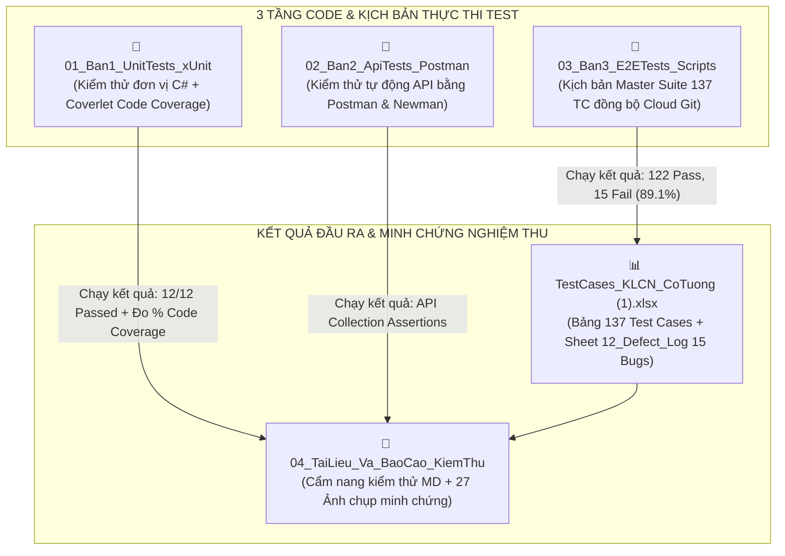

# BÁO CÁO REVIEW CƠ CHẾ HOẠT ĐỘNG CỦA 4 FOLDER KIỂM THỬ (TESTING SUITE)
## HỆ THỐNG WEBSITE CỜ TƯỚNG TRỰC TUYẾN CHESSCORE - ĐỒ ÁN TỐT NGHIỆP HUIT
### BỘ DỮ LIỆU ĐỒNG BỘ 137 TEST CASES & 15 LỖI THỰC TẾ (DEFECT LOG)

---

## 🧭 1. NGUYÊN LÝ THIẾT KẾ & SỰ KHÁC BIỆT CỐT LÕI

Hệ thống thư mục `Testing/` được phân tách khoa học theo chuẩn **Kim tự tháp kiểm thử phần mềm (Software Testing Pyramid)**. Điểm mấu chốt để bạn trình bày trước Thầy/Cô và Hội đồng chấm đồ án là:

> 📌 **NGUYÊN TẮC VÀNG:**  
> * **Folder 1, Folder 2, Folder 3** là **MÃ NGUỒN & KỊCH BẢN THỰC THI KIỂM THỬ (TEST CODE / SUITES)**.  
> * **Folder 4** là **KẾT QUẢ ĐẦU RA, BÁO CÁO NGHIỆM THU & BẰNG CHỨNG HỌC THUẬT (TEST DELIVERABLES)**.



---

## 🔍 2. REVIEW CHI TIẾT CÁCH HOẠT ĐỘNG CỦA TỪNG FOLDER

### 🟢 FOLDER 1: `01_Ban1_UnitTests_xUnit` (Kiểm thử Đơn vị & Đo Code Coverage)
* **Người phụ trách**: Bạn 1 (Phụ trách Engine cờ & Thuật toán AI).
* **Mã nguồn chính**: `ChessRulesAndAiTests.cs` (nằm trong project `ChessCore.Tests.csproj`).
* **Cơ chế hoạt động**:
  1. **Không phụ thuộc Web Server hay Database**: Dự án test tham chiếu trực tiếp thư viện `ChessCore.csproj` ở tầng mã nguồn nhị phân (DLL).
  2. **Kiểm tra tính đúng đắn của logic cờ**:
     - Nạp trạng thái bàn cờ qua chuỗi FEN hoặc tọa độ ban đầu.
     - Kích hoạt bộ tạo nước đi (`MoveGenerator`).
     - Dùng các khẳng định logic (`Assert.True`, `Assert.Equal`, `Assert.Contains`) để chứng minh quân cờ đi đúng luật: Mã bị cản chân không được nhảy, Tượng không qua sông, Tướng không được đối mặt trực diện, Xe/Pháo ăn quân chính xác.
  3. **Kiểm tra thuật toán AI Minimax & Alpha-Beta**:
     - Đo độ sâu duyệt cờ (Depth 1, 2, 3).
     - Kiểm tra hàm lượng giá thế trận Heuristic (`H1: Quân lực`, `H2: Vị trí PST`, `H3: Độ cơ động`, `H4: An toàn Tướng`).
  4. **Tích hợp Coverlet Code Coverage**:
     - Tự động đo lường độ bao phủ dòng lệnh (Line Coverage) và nhánh rẽ (Branch Coverage) của Engine luật cờ và AI.
* **Lệnh kích hoạt**: 
  ```powershell
  dotnet test Testing/01_Ban1_UnitTests_xUnit/ChessCore.Tests.csproj --collect:"XPlat Code Coverage"
  ```

---

### 🟡 FOLDER 2: `02_Ban2_ApiTests_Postman` (Kiểm thử Giao tiếp Dịch vụ API)
* **Người phụ trách**: Bạn 2 (Phụ trách Dịch vụ Backend & API Integration).
* **Tài nguyên**: 
  - `ChessCore_APIs.postman_collection.json` (Bộ sưu tập các request API).
  - `ChessCore_Local.postman_environment.json` (Biến môi trường: `baseUrl`, `jwt_token`, `game_id`).
* **Cơ chế hoạt động**:
  1. **Yêu cầu môi trường**: Web Server Kestrel phải đang chạy tại `http://localhost:5000`.
  2. **Tự động hóa luồng API (Request Chaining)**:
     - Gửi `POST /api/auth/login` trích xuất JWT Token lưu vào `{{jwt_token}}`.
     - Gửi `POST /api/games` đính kèm Token tạo phòng cờ, lưu mã ván vào `{{game_id}}`.
     - Tự động kiểm tra các thao tác đi cờ, gợi ý, cờ thế, khóa học.
  3. **Tự động hóa qua Newman CLI**:
     - Chạy dòng lệnh không cần mở giao diện Postman, kiểm tra tự động các Assertions HTTP status và dữ liệu trả về.
* **Lệnh kích hoạt**: 
  ```powershell
  npx newman run Testing/02_Ban2_ApiTests_Postman/ChessCore_APIs.postman_collection.json -e Testing/02_Ban2_ApiTests_Postman/ChessCore_Local.postman_environment.json
  ```

---

### 🔵 FOLDER 3: `03_Ban3_E2ETests_Scripts` (Tự động hóa Toàn trình 137 Test Cases)
* **Người phụ trách**: Bạn 3 (Phụ trách Đảm bảo chất lượng QA / E2E Automation).
* **Mã nguồn trọng tâm**: [`run_suite_137.py`](file:///c:/Users/ADMIN/Desktop/C-T-ng-/Testing/03_Ban3_E2ETests_Scripts/run_suite_137.py).
* **Cơ chế hoạt động**:
  1. **Tự động đồng bộ mã nguồn Git Cloud**:
     - Tự động kiểm tra và pull mã nguồn mới nhất từ nhánh `origin/main` trên GitHub.
     - Trích xuất Commit Hash, Tác giả (Author), Ngày giờ pull và ghi trực tiếp vào trang bìa `01_Cover_Info` của file Excel.
  2. **Tự động thực thi toàn bộ 137 Test Cases trên 8 phân hệ**:
     - Xác thực & Tài khoản (`04_TC_Auth_Profile` - 17 TCs)
     - Bộ luật cờ tướng (`05_TC_Chess_Rules` - 26 TCs)
     - Chế độ chơi & AI (`06_TC_Game_Play` - 18 TCs)
     - Đấu online SignalR (`07_TC_Online_SignalR` - 20 TCs)
     - Cờ thế & Timerush (`08_TC_Puzzle_Cothe` - 16 TCs)
     - Khóa học & Kỳ phổ (`09_TC_Course_Master` - 16 TCs)
     - Quản trị viên Admin (`10_TC_Admin_System` - 12 TCs)
     - Đặc thù Di động (`11_TC_Mobile_Specific` - 12 TCs)
  3. **Ghi nhận Defect Bug Log tự động**:
     - Khi phát hiện ca kiểm thử thất bại (Fail), script không tự ý sửa code lập trình viên mà tự động ghi nhận vào Sheet `12_Defect_Log`.
* **Lệnh kích hoạt**: 
  ```powershell
  python Testing/03_Ban3_E2ETests_Scripts/run_suite_137.py
  ```

---

### 🟣 FOLDER 4: `04_TaiLieu_Va_BaoCao_KiemThu` (Nơi Lưu Trữ Kết Quả & Nghiệm Thu)
* **Bản chất**: Nơi lưu trữ toàn bộ hồ sơ nghiệm thu, cẩm nang hướng dẫn kiểm thử và bằng chứng hình ảnh.
* **Các thành phần cụ thể**:
  1. [`HUONG_DAN_KIEM_THU_TOAN_DIEN_137_TC_VA_15_BUGS.md`](file:///c:/Users/ADMIN/Desktop/C-T-ng-/Testing/04_TaiLieu_Va_BaoCao_KiemThu/HUONG_DAN_KIEM_THU_TOAN_DIEN_137_TC_VA_15_BUGS.md):
     - Cẩm nang chi tiết hướng dẫn tự tay kiểm thử và tái hiện 15 lỗi thực tế kèm mã script copy-paste ngay trên trình duyệt hoặc PowerShell.
  2. [`E2E_SCREENSHOTS/`](file:///c:/Users/ADMIN/Desktop/C-T-ng-/Testing/04_TaiLieu_Va_BaoCao_KiemThu/E2E_SCREENSHOTS/):
     - **27 ảnh chụp màn hình độ phân giải cao**: Gồm 19 ảnh chụp giao diện thành công (Pass) và 8 thẻ ảnh chụp chứng cứ lỗi (Defect Evidence Cards) đối chiếu trực tiếp với Sheet `12_Defect_Log`.

---

## 📊 3. BẢNG TỔNG KẾT SO SÁNH 4 FOLDER

| Tiêu chí | Folder 1 (`UnitTests_xUnit`) | Folder 2 (`ApiTests_Postman`) | Folder 3 (`E2ETests_Scripts`) | Folder 4 (`TaiLieu_Va_BaoCao`) |
| :--- | :--- | :--- | :--- | :--- |
| **Bản chất** | **Mã nguồn test (C#)** | **Kịch bản test (JSON)** | **Kịch bản tự động (Python)** | **KẾT QUẢ & BẰNG CHỨNG** |
| **Tầng kiểm thử** | Unit Test (Tầng sâu logic) | API Test (Tầng giao tiếp) | E2E Test (Tầng toàn trình) | Nghiệm thu & Chấm điểm |
| **Công nghệ** | C# (.NET xUnit + Coverlet) | Postman Collection / Newman | Python 3.11 Automation | Markdown Guide, PNG Screenshots |
| **Cần bật Web?** | ❌ Không cần |  Cần chạy Kestrel (5000) |  Cần chạy Kestrel (5000) | ❌ Không cần |
| **Lệnh thực thi** | `dotnet test` | `npx newman run ...` | `python .../run_suite_137.py` | Mở xem / Nộp Hội đồng |
| **Số lượng ca** | 12 Unit Tests | Toàn bộ API Endpoints | 137 Test Cases | **Tổng hợp 137 TC + 15 Bugs** |

---

> [!TIP]
> **KHI ĐI BẢO VỆ ĐỒ ÁN:**
> 1. Khi Hội đồng muốn xem **Báo cáo và kết quả nghiệm thu**: Bạn mở file Excel [TestCases_KLCN_CoTuong (1).xlsx](file:///c:/Users/ADMIN/Desktop/C-T-ng-/Testing/TestCases_KLCN_CoTuong%20(1).xlsx) (Sheet `03_Test_Summary` và Sheet `12_Defect_Log`).
> 2. Khi Hội đồng yêu cầu **"Em hãy chứng minh đây là số liệu test thật bằng cách chạy trực tiếp trước mặt thầy/cô"**:
>    - Chạy Unit Test: `dotnet test Testing/01_Ban1_UnitTests_xUnit/ChessCore.Tests.csproj`
>    - Chạy API Test tự động: `npx newman run Testing/02_Ban2_ApiTests_Postman/ChessCore_APIs.postman_collection.json -e Testing/02_Ban2_ApiTests_Postman/ChessCore_Local.postman_environment.json`
>    - Chạy Bộ Master Matrix 137 ca: `python Testing/03_Ban3_E2ETests_Scripts/run_suite_137.py`
