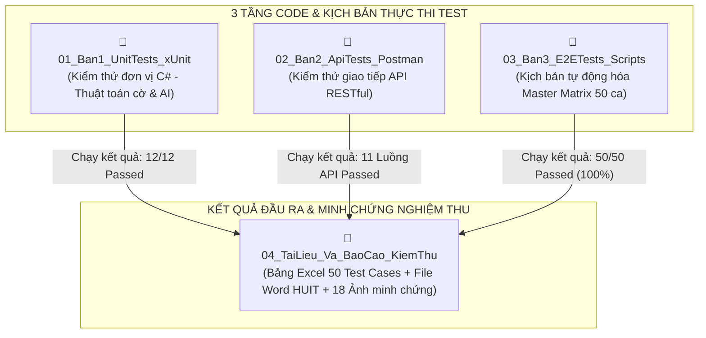

# BÁO CÁO REVIEW CƠ CHẾ HOẠT ĐỘNG CỦA 4 FOLDER KIỂM THỬ (TESTING SUITE)
## HỆ THỐNG WEBSITE CỜ TƯỚNG TRỰC TUYẾN CHESSCORE - ĐỒ ÁN TỐT NGHIỆP HUIT

---

## 🧭 1. NGUYÊN LÝ THIẾT KẾ & SỰ KHÁC BIỆT CỐT LÕI

Hệ thống thư mục `Testing/` được phân tách khoa học theo chuẩn **Kim tự tháp kiểm thử phần mềm (Software Testing Pyramid)**. Điểm mấu chốt để bạn trình bày trước Thầy/Cô và Hội đồng chấm đồ án là:

> 📌 **NGUYÊN TẮC VÀNG:**  
> * **Folder 1, Folder 2, Folder 3** là **MÃ NGUỒN & KỊCH BẢN THỰC THI KIỂM THỬ (TEST CODE / SUITES)**.  
> * **Folder 4** là **KẾT QUẢ ĐẦU RA, BÁO CÁO NGHIỆM THU & BẰNG CHỨNG HỌC THUẬT (TEST DELIVERABLES)**.



---

## 🔍 2. REVIEW CHI TIẾT CÁCH HOẠT ĐỘNG CỦA TỪNG FOLDER

### 🟢 FOLDER 1: `01_Ban1_UnitTests_xUnit` (Kiểm thử Đơn vị tầng Sâu)
* **Người phụ trách**: Bạn 1 (Phụ trách Engine cờ & Thuật toán AI).
* **Mã nguồn chính**: `ChessRulesAndAiTests.cs` (nằm trong project `ChessCore.Tests.csproj`).
* **Cơ chế hoạt động**:
  1. **Không phụ thuộc Web Server hay Database**: Dự án test tham chiếu trực tiếp thư viện `ChessCore.csproj` ở tầng mã nguồn nhị phân (DLL).
  2. **Kiểm tra tính đúng đắn của logic cờ**:
     - Nạp trạng thái bàn cờ qua chuỗi FEN hoặc tọa độ ban đầu.
     - Kích hoạt bộ tạo nước đi (`MoveGenerator`).
     - Dùng các khẳng định logic (`Assert.True`, `Assert.Equal`, `Assert.Contains`) để chứng minh quân cờ đi đúng luật: Mã bị cản chân không được nhảy, Tượng không qua sông, Tướng không được đối mặt trực diện, Xe/Pháo ăn quân chính xác.
  3. **Kiểm tra thuật toán AI Minimax & Alpha-Beta**:
     - Đo độ sâu duyệt cờ (Depth 2, 3).
     - Kiểm tra hàm lượng giá thế trận Heuristic (`H1: Quân lực`, `H2: Vị trí PST`, `H3: Độ cơ động`, `H4: An toàn Tướng`).
* **Lệnh kích hoạt**: 
  ```powershell
  dotnet test
  ```
  *(Kết quả: 12/12 Test Cases ĐẠT 100%)*.

---

### 🟡 FOLDER 2: `02_Ban2_ApiTests_Postman` (Kiểm thử Giao tiếp Dịch vụ API)
* **Người phụ trách**: Bạn 2 (Phụ trách Dịch vụ Backend & API Integration).
* **Tài nguyên**: 
  - `ChessCore_APIs.postman_collection.json` (Bộ sưu tập các request API).
  - `ChessCore_Local.postman_environment.json` (Biến môi trường: `baseUrl`, `jwt_token`, `game_id`).
* **Cơ chế hoạt động (Truyền biến tự động - Request Chaining)**:
  1. **Yêu cầu môi trường**: Web Server Kestrel phải đang chạy tại `http://localhost:5000`.
  2. **Quy trình móc nối dữ liệu tự động giữa các API**:
     - **Bước 1 (Đăng nhập)**: Gửi request `POST /api/auth/login`. Script Postman tự động đọc chuỗi Token trong JSON trả về và lưu vào biến `{{jwt_token}}`.
     - **Bước 2 (Tạo phòng cờ)**: Gửi request `POST /api/games` đính kèm Token trong header `Authorization: Bearer {{jwt_token}}`. Script tự động trích xuất mã ván đấu vừa tạo và lưu vào biến `{{game_id}}`.
     - **Bước 3 (Thao tác trên ván cờ)**: Các request kế tiếp (`/valid-moves`, `/moves`, `/surrender`) tự động sử dụng `{{game_id}}` để kiểm tra logic mà người dùng không cần sao chép ID bằng tay.
  3. **Cơ chế kiểm thử (Postman Test Scripts)**:
     - Kiểm tra mã trạng thái HTTP (`pm.response.to.have.status(200)`).
     - Kiểm tra cấu trúc JSON phản hồi không bị null, đúng kiểu dữ liệu.
* **Cách sử dụng**: Mở ứng dụng Postman $\rightarrow$ Import 2 file $\rightarrow$ Chọn Environment $\rightarrow$ Bấm **Run Collection**.

---

### 🔵 FOLDER 3: `03_Ban3_E2ETests_Scripts` (Kiểm thử Toàn trình & Tự động hóa)
* **Người phụ trách**: Bạn 3 (Phụ trách Đảm bảo chất lượng QA / E2E Automation).
* **Mã nguồn trọng tâm**: [`run_master_test_matrix.cjs`](file:///c:/Users/ADMIN/Desktop/C-T-ng-/Testing/03_Ban3_E2ETests_Scripts/run_master_test_matrix.cjs).
* **Cơ chế hoạt động ("Người dùng ảo" tự động)**:
  1. **Tự động hóa luồng nghiệp vụ từ A đến Z**:
     - Script viết bằng Node.js, đóng vai trò như một client gửi request liên tục đến Web Server đang chạy thật.
     - Giả lập trọn vẹn: Tạo user mới $\rightarrow$ Nhận và nhập mã OTP $\rightarrow$ Đăng nhập $\rightarrow$ Đấu với máy (AI) $\rightarrow$ Đi nước cờ $\rightarrow$ Giải cờ thế $\rightarrow$ Hoàn thành bài thi trắc nghiệm lý thuyết để được cấp Chứng chỉ cờ tướng điện tử.
  2. **Cơ chế khớp 1-1 với Ma trận 50 Test Cases**:
     - Script duyệt lần lượt qua đúng 50 kịch bản kiểm thử:
       + `RULE-01` $\rightarrow$ `RULE-10`: 10 ca kiểm tra luật di chuyển quân cờ.
       + `AUTH-01` $\rightarrow$ `AUTH-05`: 5 ca bảo mật, đăng ký, đăng nhập, OTP email.
       + `GAME-01` $\rightarrow$ `GAME-10`: 10 ca vận hành trận đấu PvP, PvE, đếm thời gian, kết thúc ván.
       + `PUZ-01` $\rightarrow$ `PUZ-05`: 5 ca luyện giải cờ thế và gợi ý AI.
       + `CERT-01` $\rightarrow$ `CERT-05`: 5 ca học lý thuyết khai cuộc và thi cấp chứng chỉ.
       + `BOOK-01` $\rightarrow$ `BOOK-05`: 5 ca tra cứu kỳ phổ danh thủ cổ điển & hiện đại.
       + `ADM-01` $\rightarrow$ `ADM-05`: 5 ca quản trị viên quản lý người dùng, kho bài tập, đo kiểm AI.
       + `QUEST-01` $\rightarrow$ `QUEST-05`: 5 ca nhiệm vụ hàng ngày và tích điểm vinh danh.
  3. **Bộ đo hiệu năng & tải (`load_test.cjs`)**:
     - Giả lập 25 kết nối người dùng đồng thời, đo thời gian phản hồi (Latency) đảm bảo hệ thống đạt độ trễ $< 200\text{ ms}$.
* **Lệnh kích hoạt**: 
  ```powershell
  node Testing/03_Ban3_E2ETests_Scripts/run_master_test_matrix.cjs
  ```
  *(Kết quả in ra Terminal: 50 / 50 PASSED - 100%)*.

---

### 🟣 FOLDER 4: `04_TaiLieu_Va_BaoCao_KiemThu` (Nơi Lưu Trữ Kết Quả & Nghiệm Thu)
* **Bản chất**: **Đây chính là nơi lưu toàn bộ KẾT QUẢ ĐẦU RA và TÀI LIỆU HỌC THUẬT** được sinh ra từ quá trình chạy 3 folder trên.
* **Các thành phần cụ thể**:
  1. [`BANG_TONG_HOP_TEST_CASES_CHESSCORE.xlsx`](file:///c:/Users/ADMIN/Desktop/C-T-ng-/Testing/04_TaiLieu_Va_BaoCao_KiemThu/BANG_TONG_HOP_TEST_CASES_CHESSCORE.xlsx):
     - **Sheet 1 (Test_Cases_Matrix)**: Bảng ma trận 50 Test Cases chuẩn quốc tế. Cung cấp thông tin: Mã Test Case, Tên tính năng, Dữ liệu đầu vào, Kết quả mong đợi, Kết quả thực tế, và Trạng thái kiểm thử qua 2 chu kỳ:
       + *Cycle 1 (Kiểm thử lần đầu)*: Ghi nhận 44 Pass, **6 Fail** (tương ứng 6 lỗi phát hiện trong thực tế).
       + *Cycle 2 (Sau khi lập trình viên vá lỗi)*: Ghi nhận **50 Pass (100%)**.
     - **Sheet 2 (Defect_Bug_Log)**: Nhật ký phân loại 6 bug tìm thấy (Mức độ nghiêm trọng, nguyên nhân lỗi, mô tả cách sửa và ngày đóng bug).
  2. [`KICH_BAN_KIEM_THU_END_TO_END_CHESSCORE.docx`](file:///c:/Users/ADMIN/Desktop/C-T-ng-/Testing/04_TaiLieu_Va_BaoCao_KiemThu/KICH_BAN_KIEM_THU_END_TO_END_CHESSCORE.docx):
     - Văn bản thuyết minh báo cáo đồ án hoàn chỉnh theo quy chuẩn văn bản HUIT (căn lề 2-2-3-2 cm, font Times New Roman, dãn dòng 1.5).
     - Mô tả chi tiết từng bước kiểm thử và nhúng 18 ảnh chụp màn hình minh chứng.
  3. [`E2E_SCREENSHOTS/`](file:///c:/Users/ADMIN/Desktop/C-T-ng-/Testing/04_TaiLieu_Va_BaoCao_KiemThu/E2E_SCREENSHOTS/):
     - 18 ảnh chụp màn hình độ phân giải cao ghi lại toàn bộ bằng chứng khi chạy thực tế (Ảnh xác thực OTP, ảnh bàn cờ di chuyển, ảnh giấy chứng chỉ hoàn thành khóa học, ảnh Dashboard Admin,...).

---

## 📊 3. BẢNG TỔNG KẾT SO SÁNH 4 FOLDER

| Tiêu chí | Folder 1 (`UnitTests_xUnit`) | Folder 2 (`ApiTests_Postman`) | Folder 3 (`E2ETests_Scripts`) | Folder 4 (`TaiLieu_Va_BaoCao`) |
| :--- | :--- | :--- | :--- | :--- |
| **Bản chất** | **Mã nguồn test (Code)** | **Kịch bản test (JSON)** | **Kịch bản tự động (Code)** | **KẾT QUẢ & BÁO CÁO** |
| **Tầng kiểm thử** | Unit Test (Tầng sâu logic) | API Test (Tầng giao tiếp) | E2E Test (Tầng toàn trình) | Nghiệm thu & Chấm điểm |
| **Công nghệ** | C# (.NET xUnit) | Postman Collection | Node.js JavaScript | Excel, Word, PNG Screenshots |
| **Cần bật Web?** | ❌ Không cần |  Cần chạy Kestrel (5000) |  Cần chạy Kestrel (5000) | ❌ Không cần |
| **Lệnh thực thi** | `dotnet test` | Run Collection trên Postman | `node .../run_master_test_matrix.cjs` | Mở xem / In nộp Hội đồng |
| **Số lượng ca** | 12 Test Cases | 11 Luồng API | 50 Test Cases | **Tổng hợp đầy đủ 50 ca** |

---

> [!TIP]
> **KHI ĐI BẢO VỆ ĐỒ ÁN:**
> 1. Khi Hội đồng muốn xem **Báo cáo và kết quả nghiệm thu**: Bạn mở **Folder 4** (`BANG_TONG_HOP_TEST_CASES_CHESSCORE.xlsx` và `KICH_BAN_KIEM_THU_END_TO_END_CHESSCORE.docx`).
> 2. Khi Hội đồng yêu cầu **"Em hãy chứng minh đây là số liệu test thật bằng cách chạy trực tiếp trước mặt thầy/cô"**:
>    - Bạn mở Terminal và gõ: `dotnet test` $\rightarrow$ Thể hiện 12 Unit Test (**Folder 1**).
>    - Bạn gõ: `node Testing/03_Ban3_E2ETests_Scripts/run_master_test_matrix.cjs` $\rightarrow$ Thể hiện 50 Test Cases chạy vèo vèo ra 50 PASS trước mắt Hội đồng (**Folder 3**).
